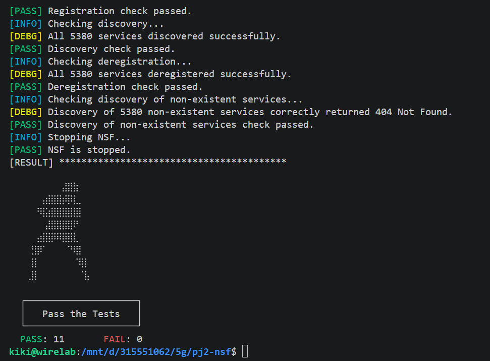

- 學號: 315551062
- 姓名: 黃詠綺
- github: https://github.com/ki225/pj2-nsf
- 實作說明
    - GET /sbi/heartbeat：回傳 HTTP 204，確認 NSF 正常回應。
    - POST /sbi/nnsf-nfm：登記 NF 名稱、IP、Port 與服務清單，把資料轉為 JSON 寫入 DB，成功後更新記憶體服務表。
    - DELETE /sbi/nnsf-nfm：確認指定服務存在且屬於該 NF，再刪除 DB 與記憶體中的紀錄
    - GET /sbi/nnsf-disc：依服務名稱查詢記憶體服務表，回傳提供者資訊，不存在則回傳 HTTP 404。
    - GET /sbi/nnsf-disc/group：逐一查詢指定服務，將找到的提供者資訊組成陣列回傳。
    - NSF Recovery：啟動時透過 LoadAll() 讀取 DB，解析 JSON 並恢復服務表
- 測試結果
    - docker test 
    - GitHub Actions 
- DB 抽換
    - 使用的 DB: 預設用 bbolt，自訂 DB 使用 MongoDB，兩者皆實作相同的 `DbIf` 介面。MongoDB 目前使用預設連線 `mongodb://127.0.0.1:27017`，資料存放於 `nsf.services`。
    - 切換方式: 先啟動 MongoDB，將 `config.yaml` 的 `nsf.db_type` 從 `"bbolt"` 改成 `"custom"`
    - 影片: 在 src/vid/ 
    - 流程:
        1. 啟動 bbolt
        2. 註冊服務到 bbolt
        3. 查詢證明 bbolt 有資料
        4. 啟動&確認 MongoDB 為空
        5. migrate bbolt 資料到 MongoDB (有另外的腳本在 ./cmd/db-migrate)
        6. 查 MongoDB，證明資料已搬入
        7. 切換 customDB(mongodb)
        8. 不重新註冊，直接查詢
        9. end
